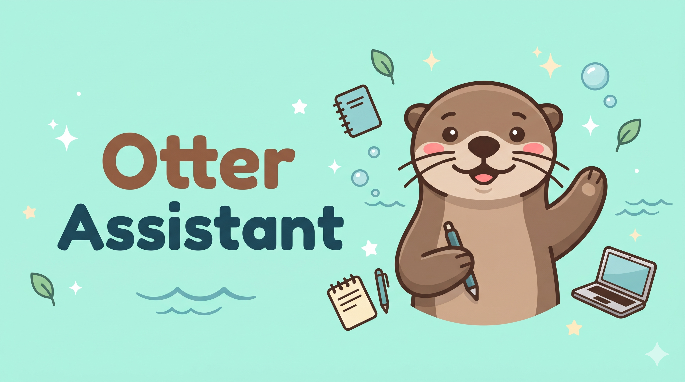
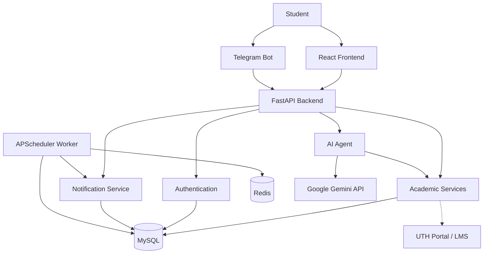

# Otter Assistant

<p align="center">
  
</p>

<p align="center">
  <strong>Your schedule. Your tasks. Your Otter.</strong>
  <br />
  An AI-powered personal academic assistant built for students of the University of Transport Ho Chi Minh City (UTH).
</p>

<p align="center">
  <a href="https://github.com/dmins06/OtterAssistant">
    
  </a>
  
  
  
  
  
  
  
  
</p>

---

## Overview

Otter Assistant is an AI-powered academic management system designed to help university students organize their academic activities through a centralized platform.

The system combines academic data management, AI-assisted interactions, automated reminders, and Telegram integration to provide a more convenient way to keep track of university life.

Rather than functioning as a general-purpose chatbot, Otter Assistant is designed around academic workflows: schedules, subjects, assignments, reminders, and student-specific information.

## Key Features

### Academic Management
- Manage academic subjects and course information.
- Organize class schedules based on UTH timetable structures.
- Track assignments and academic tasks.
- Detect potential timetable conflicts.
- Keep academic information organized in one place.

### AI Assistant
- Interact with an AI assistant powered by Google Gemini.
- Use a tool-based agent architecture to work with academic data.
- Support context-aware conversations.
- Maintain conversation history and memory management.
- Separate AI provider logic through a pluggable LLM provider interface.

### Automated Notifications
- Schedule class and assignment reminders.
- Support custom reminders.
- Generate daily and weekly academic summaries.
- Use scheduled background jobs to process notifications.
- Apply idempotency mechanisms to reduce duplicate notifications.

### Telegram Integration
- Connect a student account to a Telegram bot.
- Link accounts using one-time verification codes.
- Receive academic reminders through Telegram.
- Process incoming messages through a verified HTTPS webhook.

### Application Security
- JWT-based authentication.
- User-isolated data access.
- Encrypted sensitive integration credentials.
- Structured logging with sensitive-data redaction.
- Rate limiting for selected API endpoints.
- Environment-based configuration.

## Technology Stack

| Layer | Technologies |
|---|---|
| Backend | Python 3.12+, FastAPI, Uvicorn |
| API & Validation | Pydantic v2, HTTPX |
| ORM & Migrations | SQLAlchemy 2.x, Alembic |
| Frontend | React 19, TypeScript, Vite |
| Web Server | Nginx |
| Database | MySQL 8.0+ |
| Cache & Distributed Locking | Redis 7 |
| AI Integration | Google Gemini API, `google-genai` |
| AI Architecture | Tool-based Agent, LLM Provider Interface |
| Background Scheduling | APScheduler |
| Authentication & Security | JWT, Fernet Encryption |
| Containerization | Docker, Docker Compose |
| Testing | Pytest |
| Version Control | Git, GitHub |

## System Architecture

Otter Assistant follows a modular monolith architecture. The backend is organized into independent modules for API handling, business logic, data access, integrations, AI orchestration, and scheduled jobs.



### Architecture Principles

- Modular separation of responsibilities.
- Centralized configuration through environment variables.
- SQLAlchemy-based data access.
- MySQL as the primary source of truth.
- Redis for caching, rate limiting, and distributed coordination.
- Independent scheduler worker for background processing.
- Provider abstraction to reduce coupling between the AI agent and LLM implementation.

## Project Structure

```text
OtterAssistant/
├── backend/
│   ├── app/
│   │   ├── agents/          # AI agent, LLM providers, prompts, memory
│   │   ├── api/             # FastAPI routes and dependencies
│   │   ├── core/            # Configuration, security, logging
│   │   ├── database/        # SQLAlchemy setup and sessions
│   │   ├── integrations/    # UTH Portal, LMS, Telegram
│   │   ├── models/          # Database models
│   │   ├── notifications/   # Notification services
│   │   ├── repositories/    # Data access layer
│   │   ├── scheduler/       # Scheduled jobs and worker
│   │   ├── schemas/         # Pydantic schemas
│   │   ├── services/        # Academic business logic
│   │   └── tools/           # AI agent tools
│   ├── alembic/             # Database migrations
│   └── tests/               # Backend tests
│
├── frontend/
│   ├── src/                 # React application
│   ├── public/              # Static assets
│   └── ...                  # Vite and Nginx configuration
│
├── docs/
│   └── assets/
│       └── otter-assistant-banner.png
│
├── docker-compose.yml
├── docker-compose.prod.yml
├── .env.example
├── .gitignore
├── .gitleaksignore
└── README.md
```

## Getting Started

### Prerequisites

Make sure the following tools are installed:

- Python 3.12 or later
- Node.js and npm
- Docker Engine
- Docker Compose
- Git

You will also need the credentials for the external services you intend to enable, such as Google Gemini and Telegram.

### 1. Clone the Repository

```bash
git clone https://github.com/dmins06/OtterAssistant.git

cd OtterAssistant
```

### 2. Configure Environment Variables

Create your local environment file:

```bash
cp .env.example .env
```

Open `.env` and configure the required values.

Generate a secure application secret:

```bash
python3 -c "import secrets; print(secrets.token_urlsafe(32))"
```

Generate a Fernet encryption key:

```bash
python3 -c "from cryptography.fernet import Fernet; print(Fernet.generate_key().decode())"
```

Configure the generated values and the required database, Redis, AI, and Telegram credentials in `.env`.

Do not commit `.env` or expose API keys, tokens, passwords, or encryption keys.

### 3. Start the Application

Build and start the development environment:

```bash
docker compose up --build -d
```

Run database migrations:

```bash
docker compose exec backend alembic upgrade head
```

### 4. Access the Application

| Service | URL |
|---|---|
| Frontend | http://localhost:5173 |
| Backend API | http://localhost:8000 |
| API Documentation | http://localhost:8000/docs |
| Health Check | http://localhost:8000/health |
| Readiness Check | http://localhost:8000/health/ready |

The available endpoints depend on the application's configuration and deployment environment.

## Running Tests

### Backend

```bash
cd backend

python3 -m venv .venv

source .venv/bin/activate

pip install -r requirements.txt

pytest -v
```

### Frontend

```bash
cd frontend

npm install

npm run typecheck

npm run build
```

## Production Deployment

A production-oriented Docker Compose configuration is provided:

```bash
docker compose -f docker-compose.prod.yml up --build -d
```

The production configuration is designed to support:

- A dedicated scheduler worker.
- Multiple API workers.
- Database migration before application startup.
- Non-root container execution.
- Production configuration checks.
- Security headers and API rate limiting.

Before exposing the application to real student traffic, configure and verify all external integrations with authorized credentials.

## External Integrations

| Integration | Purpose |
|---|---|
| Google Gemini API | AI-powered conversations and tool execution |
| UTH Portal | Academic timetable integration |
| UTH LMS | Course and assignment integration |
| Telegram Bot API | Notifications and chatbot interaction |
| MySQL | Persistent academic and application data |
| Redis | Cache, rate limiting, and distributed locking |

Some integrations require additional configuration and verification against the corresponding external services. Their availability depends on credentials, provider access, and deployment settings.

## Configuration & Security

Otter Assistant uses environment-based configuration to separate application settings from source code.

Important configuration areas include:

- Database connection settings.
- Redis connection settings.
- JWT signing secret.
- Fernet encryption key.
- Google Gemini API credentials and model selection.
- Telegram bot credentials and webhook secret.
- UTH Portal and LMS integration settings.
- Application environment and debug settings.

Security recommendations:

1. Never commit `.env` files or production credentials.
2. Use strong, unique secrets for each deployment.
3. Keep `APP_DEBUG=false` in production.
4. Restrict database permissions to the minimum required.
5. Use HTTPS for public-facing services and webhooks.
6. Rotate exposed credentials immediately.
7. Review logs and access controls regularly.

## Roadmap

Potential areas for future development:

- Improve academic data synchronization reliability.
- Expand AI agent capabilities and tool evaluation.
- Improve assignment tracking and notification workflows.
- Enhance conversation memory and context management.
- Add more academic productivity features.
- Improve monitoring, observability, and automated testing.

## Contributing

Contributions, bug reports, and suggestions are welcome.

1. Fork the repository.
2. Create a feature branch:

   ```bash
   git checkout -b feature/your-feature
   ```

3. Commit your changes:

   ```bash
   git commit -m "feat: add your feature"
   ```

4. Push your branch:

   ```bash
   git push origin feature/your-feature
   ```

5. Open a Pull Request.

Please keep changes focused, document significant behavior changes, and add tests where appropriate.

## License

This project is licensed under the MIT License. See the [LICENSE](LICENSE) file for details.

## Author

**Diminn**

GitHub: [@dmins06](https://github.com/dmins06)

Project Repository: [OtterAssistant](https://github.com/dmins06/OtterAssistant)

---

<p align="center">
  Built to make academic life more organized, connected, and manageable.
  <br />
  <strong>Your schedule. Your tasks. Your Otter.</strong>
</p>
